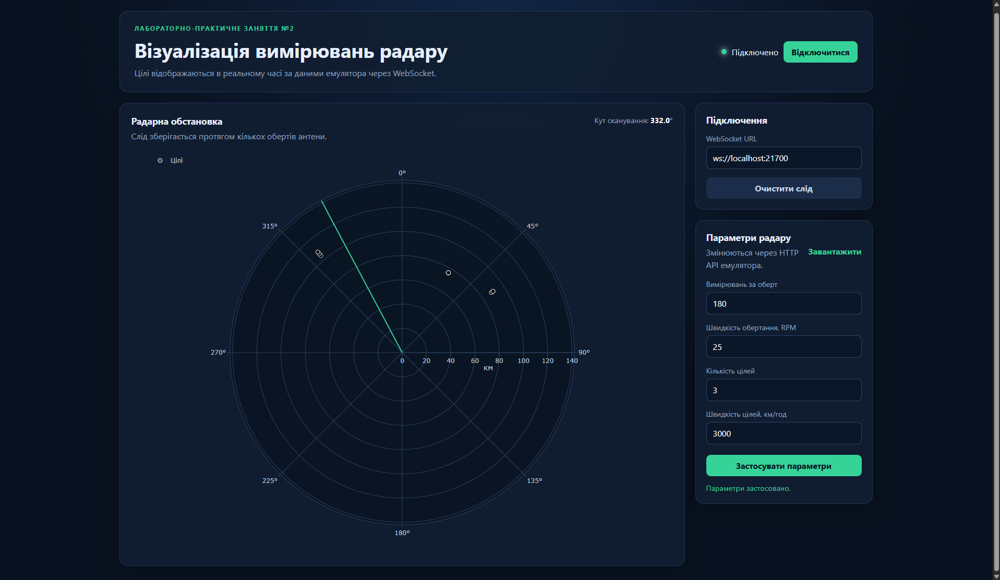
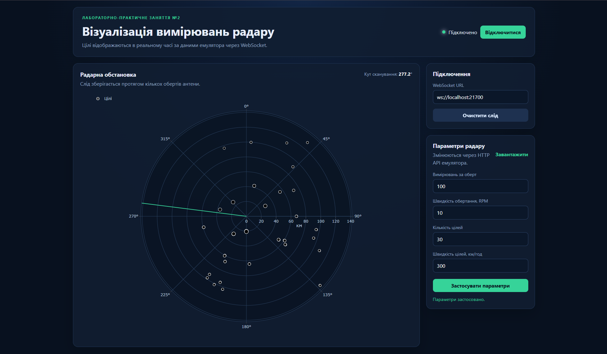
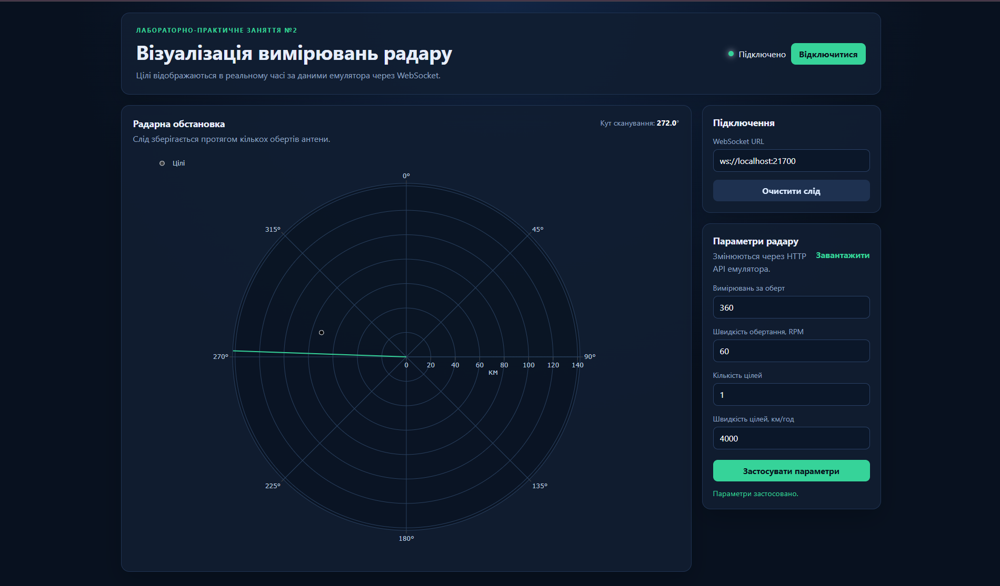

# Візуалізація вимірювань радару

Вебзастосунок для лабораторно-практичного заняття №2. Застосунок отримує повідомлення від емулятора вимірювальної частини радару через WebSocket і в реальному часі відображає виявлені цілі на графіку в полярних координатах.

## Мета та реалізовані можливості

Мета роботи - розробити застосунок, який зчитує дані з емулятора радару, обробляє їх і показує виявлені цілі на полярному графіку.

Реалізовано обов'язкову частину:

- підключення до WebSocket-сервера `ws://localhost:21700`;
- розбір JSON-повідомлень радару;
- перерахунок часу поширення сигналу у відстань;
- відображення цілей на полярному графіку в реальному часі;
- відображення відстані в кілометрах у діапазоні всієї зони емуляції;
- поступове згасання точок попередніх обертів антени;
- відображення поточного кута сканування;
- обробка порожніх повідомлень без ехо-відповідей.

Реалізовано додаткові завдання:

- завантаження поточних параметрів радару через `GET /config`;
- зміна параметрів через `PUT /config` з інтерфейсу застосунку;
- візуальне кодування потужності сигналу розміром і кольором точки;
- відображення стану WebSocket-з'єднання та помилок.

## Використані технології

- HTML5;
- CSS3;
- JavaScript;
- WebSocket;
- Fetch API;
- Plotly.js;
- Docker для запуску емулятора.

## Запуск емулятора

Потрібні Docker Desktop, браузер і Python або інший локальний HTTP-сервер.

Завантажити Docker image:

```bash
docker pull iperekrestov/university:radar-emulation-service-2026
```

Запустити емулятор:

```bash
docker run --rm --name radar-emulator -p 21700:21700 iperekrestov/university:radar-emulation-service-2026
```

Перевірити поточні параметри:

```bash
curl http://localhost:21700/config
```

За потреби перевірити WebSocket через `wscat`:

```bash
npx wscat -c ws://localhost:21700
```

## Запуск застосунку

У корені проєкту запустити локальний HTTP-сервер:

```bash
python -m http.server 8000
```

Відкрити в браузері:

```text
http://localhost:8000
```

У застосунку натиснути **Підключитися**. Адреса WebSocket за замовчуванням - `ws://localhost:21700`.

Застосунок використовує Plotly.js через CDN, тому під час першого відкриття сторінки потрібне підключення до Інтернету. Окреме встановлення npm-залежностей не потрібне.

## Формат даних і розрахунок відстані

Емулятор надсилає JSON-повідомлення такого формату:

```json
{
  "scanAngle": 90,
  "pulseDuration": 1,
  "echoResponses": [
    {
      "time": 0.0005,
      "power": 3.16
    }
  ]
}
```

Для кожної ехо-відповіді відстань обчислюється за формулою:

```text
R = c * t / 2
```

де `c = 300000 км/с`, а `t` - час двостороннього поширення сигналу в секундах. Наприклад, для `time = 0.0005` відстань становить 75 км.

Кут `scanAngle` має навігаційну орієнтацію: 0° - північ, 90° - схід, 180° - південь, 270° - захід. На графіку кутова вісь збільшується за годинниковою стрілкою, а нуль розташований зверху.

Порожній масив `echoResponses` є штатним повідомленням. Він оновлює положення антени, але не додає нову точку. Точки з попередніх обертів зберігаються, поступово стають прозорішими й видаляються після кількох обертів, утворюючи слід руху цілей.

## Керування параметрами радару

У правій панелі можна завантажити та змінити:

| Параметр | Допустимий діапазон | Одиниця |
|---|---:|---|
| `measurementsPerRotation` | 1–360 | вимірювань за оберт |
| `rotationSpeed` | 0,1–60 | обертів за хвилину |
| `numberOfTargets` | 1–50 | цілі |
| `targetSpeed` | 0–20 000 | км/год |

Застосунок надсилає запит `PUT http://localhost:21700/config` лише після натискання кнопки **Застосувати параметри**. Помилки API відображаються в інтерфейсі.

## Результат роботи

На скріншоті показано полярний графік із цілями, отриманими від емулятора радара. Видно поточний промінь сканування та слід цілей за попередні оберти антени.



Інтерфейс до зміни параметрів радару:



Після зміни параметрів через API в інтерфейсі:



## Висновки

Під час роботи реалізовано отримання даних у реальному часі через WebSocket і розбір JSON-повідомлень від емулятора. Практично використано Docker для запуску готового сервісу та Fetch API для зміни його параметрів. Також реалізовано перерахунок часу двостороннього поширення сигналу у відстань і відображення результату на полярному графіку з урахуванням навігаційної орієнтації кута.

## Структура проєкту

- `index.html` - розмітка україномовного інтерфейсу;
- `styles.css` - адаптивне оформлення;
- `app.js` - WebSocket, обробка даних, графік і API керування;
- `README.md` - опис роботи, запуск, результат і висновки;
